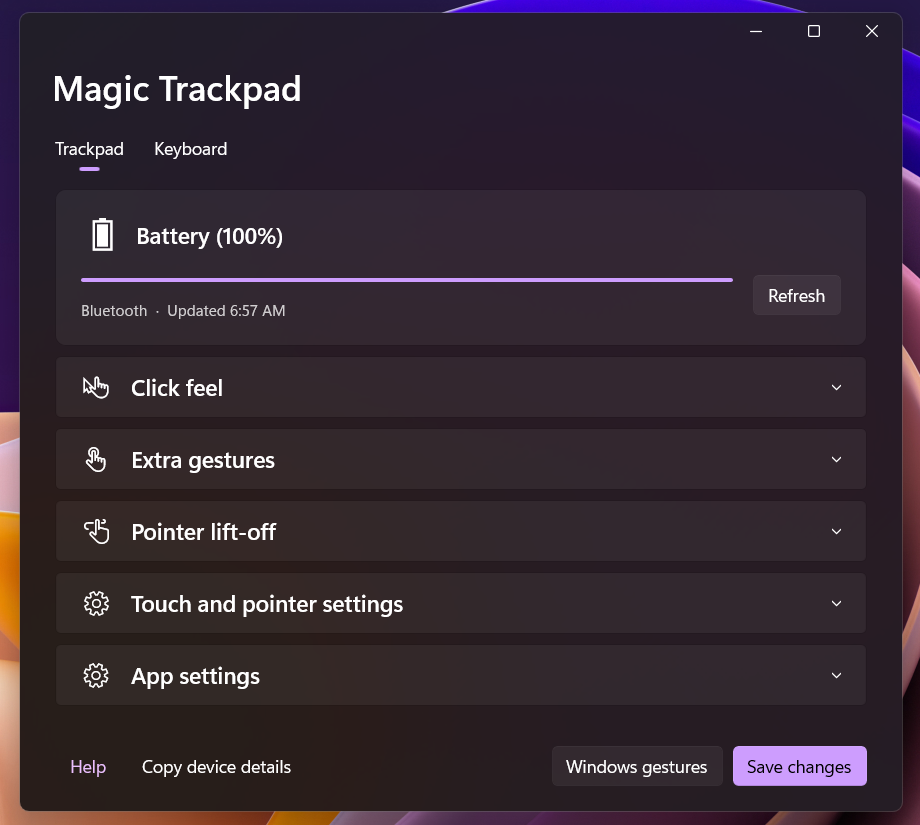
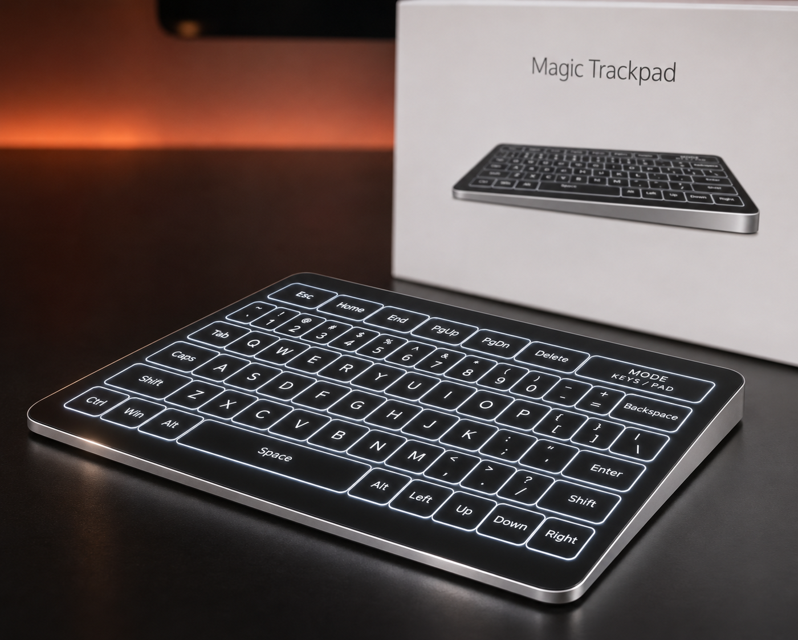

# Magic Trackpad for Windows

Use your Apple Magic Trackpad on Windows 11. Scroll with two fingers, adjust how clicks feel, and see your battery status in your taskbar.

Built on Vito Plantamura’s [MagicTrackpad2ForWindows](https://github.com/vitoplantamura/MagicTrackpad2ForWindows) driver and control panel.

You can also [type directly on the trackpad](#turn-your-trackpad-into-a-keyboard) and [use customizable five-finger gestures](#five-finger-gestures) beyond the built-in four-finger gestures in Windows.

## Get started

1. **[Download the Windows installer (1.7.9)](https://github.com/vax1ne0/magic-trackpad-setup/releases/download/v1.7.9/Magic-Trackpad-Setup-1.7.9-x64.msi)** and run it.
2. **Connect your trackpad.** Plug it in with a USB data cable, or unplug the cable and pair it under **Settings → Bluetooth & devices → Add device → Magic Trackpad**.
3. **Enjoy your full Magic Trackpad experience.** Try a two-finger scroll or pinch to zoom.

## Turn your trackpad into a keyboard

*Keyboard concept mockup. The app displays the live key layout on your screen.*

Turn the surface of your Magic Trackpad into a full QWERTY keyboard. Rest a finger on the glass and the matching key lights up on a floating keyboard. Slide to find the key you want, then click to type. The overlay follows the proportions of the trackpad, so you can learn the layout by feel. A sticker is optional.

1. Open **Keyboard** and turn on **Sticker keyboard**. Click the **top-right corner of the trackpad** to start typing. Click it again, or press **Ctrl+Alt+F10** on your physical keyboard, to switch back to pointing.
2. Try the practice box or type in your editor or chat. Closing Settings keeps Sticker keyboard available. Enable **Use two fingers to point, click, and drag in keyboard mode** to move the pointer with two fingers and physically click while both fingers rest on the glass. Keep the click held and move both fingers to select text or drag. A two-finger tap also left-clicks. While pointing, keep both fingers down and add a third. Slide up or down to scroll, then lift all fingers to resume typing. Hold a click to repeat a key. For shortcuts, rest one finger on **Shift**, **Ctrl**, **Alt**, or **Win** and press another key. Try **Shift + 2** for **@** or **Ctrl + C** to copy a selection.
3. To move the floating keyboard, hold a click in the top-right corner until the pointer and drag handle appear. Drag the handle above the keyboard into place, then click or hold the corner again to resume typing. Under **Keyboard**, you can adjust scale and transparency, enable **Tap to type**, or adjust how far and how quickly the overlay fades when idle.

If you prefer a physical guide, print the [A4 keyboard template](docs/trackpad-keyboard-a4.pdf) at **100% / Actual size**.

## Five-finger gestures

Open **Trackpad → Extra gestures** and enable **Five-finger gestures**. By default, tap with five fingers to play or pause, swipe left or right to change tracks, and slide up or down to adjust volume. A longer vertical slide changes the volume further. Each gesture has its own action picker, including **Nothing**. Gestures work while another app has focus as long as the control panel stays open.

## Features

- **Edge sliders.** Turn on **Trackpad → Extra gestures → Edge sliders**. In trackpad mode, slide one finger along the left edge for built-in display brightness or the right edge for volume. Slide toward the top for 100% or the bottom for 0%. The Windows brightness or volume slider shows the level as you move. Brightness requires a display that Windows can adjust.
- **Installer choices.** The recommended setup includes the driver, control panel, and taskbar battery indicator. Choose **Driver only** if Windows touchpad settings are all you need. Leave **Launch Magic Trackpad** checked on the final page to open the app when setup finishes.
- **Taskbar battery status.** Hover over the color-coded icon for the charge percentage and estimated hours left. The estimate learns from Bluetooth use. The icon hides when the trackpad disconnects. Under **App settings**, you can enable a 20% Bluetooth battery alert and turn on **Open at startup** to show the indicator when you sign in.
- **In-app updates.** Open **App settings → Check for updates**. A compact progress bar shows the percentage downloaded, megabytes left, and speed in MB/s. When the download finishes, choose **Restart and update** or **Update on next launch**. The second option saves the download and applies it the next time you open Magic Trackpad, or when you sign in with **Open at startup** enabled. **Restart and update** brings Settings back with a short summary of what changed.
- **Language options.** Choose your language under **App settings**, including Arabic with a right-to-left layout.

## Customization

Open **Magic Trackpad** from the Start menu. Under **Click feel**, choose a light, medium, or firm press. The feedback when you lift your finger can match the press or have its own strength. Enable **Use a quieter click** for less sound, or choose the strongest feedback for a louder click.

Prefer touch only? Turn off the physical click and its haptic feedback, then enable tap-to-click under **Windows gestures**. Under **Pointer lift-off** and **Touch and pointer settings**, you can adjust when the pointer stops, ignore accidental palm touches, and change how dragging works.

Use **Copy device details** beside **Help** when reporting a problem. Under **App settings**, **Restore trackpad defaults** lets you review the defaults before saving.

## Compatibility

Supports Windows 11 on Intel and AMD PCs with either the **2024 USB-C Magic Trackpad (A3120)** or the **2021 Lightning Magic Trackpad Gen 3 (A1535)**. The USB-C model was tested over both USB and Bluetooth.

Windows may show an unknown-publisher prompt because this community installer is unsigned. The trackpad driver is Microsoft-signed.

## Help

[Get help](docs/support.md) · [Report a problem](https://github.com/vax1ne0/magic-trackpad-setup/issues/new?template=bug_report.yml) · [Suggest a feature](https://github.com/vax1ne0/magic-trackpad-setup/issues/new?template=feature_request.yml)

## Credits

The signed driver and original settings panel come from Vito Plantamura’s [MagicTrackpad2ForWindows](https://github.com/vitoplantamura/MagicTrackpad2ForWindows), a fork of imbushuo’s [mac-precision-touchpad](https://github.com/imbushuo/mac-precision-touchpad). [Full upstream credits](https://github.com/vitoplantamura/MagicTrackpad2ForWindows#credits)

The driver and adapted settings panel retain their GPLv2 license. The installer includes their source and license in the `ThirdParty` folder. [Licensing and build details](docs/technical-details.md)

[Release notes](https://github.com/vax1ne0/magic-trackpad-setup/releases) · [Technical details and build instructions](docs/technical-details.md)
