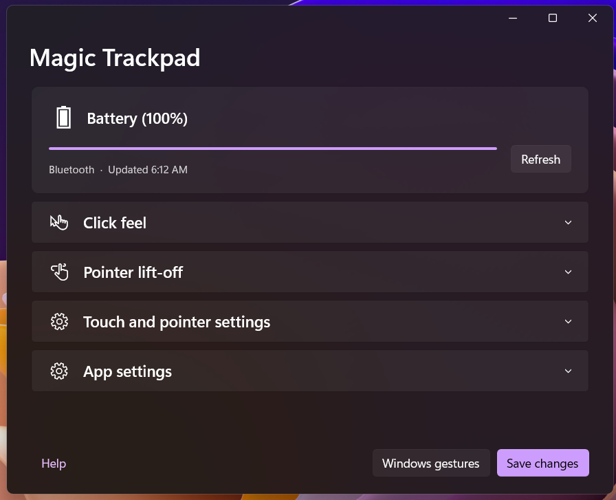

# Magic Trackpad for Windows

Use your Apple Magic Trackpad on Windows 11. Scroll with two fingers, adjust how clicks feel, and see your battery status in your taskbar.

Built on Vito Plantamura’s [MagicTrackpad2ForWindows](https://github.com/vitoplantamura/MagicTrackpad2ForWindows) driver and control panel.

## Get started

1. **[Download the Windows installer](https://github.com/vax1ne0/magic-trackpad-setup/releases/download/v1.4.0/Magic-Trackpad-Setup-1.4.0-x64.msi)** and run it.
2. **Connect your trackpad.** Plug it in with a USB data cable, or unplug the cable and pair it under **Settings → Bluetooth & devices → Add device → Magic Trackpad**.
3. **Enjoy your full Magic Trackpad experience.** Try a two-finger scroll or pinch to zoom.

## Customization

Open **Magic Trackpad** from the Start menu. Under **Click feel**, choose a light, medium, or firm click. Turn on **Use a quieter click** for less sound, or choose the strongest feedback for a louder, more pronounced click. Prefer touch only? Turn off the physical click and its haptic feedback. To click with a light tap, enable tap-to-click under **Windows gestures**.

You can also adjust when the pointer stops as you lift a finger, ignore accidental palm touches, or change how dragging works. Under **App settings**, turn on **Open at startup** to see your battery status in the taskbar when you sign in.

Hover over the battery icon for the exact percentage. After a few percentage points of Bluetooth use, it also estimates how many hours are left. If the icon is hidden, click the arrow beside the clock.

## Compatibility

Supports Windows 11 on Intel and AMD PCs with either the **2024 USB-C Magic Trackpad (A3120)** or the **2021 Lightning Magic Trackpad Gen 3 (A1535)**. The USB-C model was tested over both USB and Bluetooth.

Windows may show an unknown-publisher prompt because this community installer is unsigned. The trackpad driver is Microsoft-signed.

## Credits

The signed driver and original settings panel come from Vito Plantamura’s [MagicTrackpad2ForWindows](https://github.com/vitoplantamura/MagicTrackpad2ForWindows), a fork of imbushuo’s [mac-precision-touchpad](https://github.com/imbushuo/mac-precision-touchpad). [Full upstream credits](https://github.com/vitoplantamura/MagicTrackpad2ForWindows#credits)

The driver and adapted settings panel retain their GPLv2 license. The installer includes their source and license in the `ThirdParty` folder. [Licensing and build details](docs/technical-details.md)

## What this project adds

- One Windows installer for the driver, settings panel, and battery monitor.
- A taskbar battery icon with the charge percentage and an estimate of hours left based on Bluetooth use.
- An option to start the battery monitor at sign-in.
- A reorganized settings panel with clearer labels.
- An Arabic translation with a right-to-left layout.

[Release notes](https://github.com/vax1ne0/magic-trackpad-setup/releases) · [Technical details and build instructions](docs/technical-details.md)
